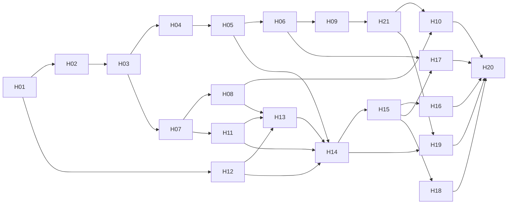

# Tracklite — Execution Plan

| | |
|---|---|
| Version | v1.5 |
| Date | 2026-11-05 |
| Inputs | [`tracklite-spec.md`](tracklite-spec.md) (v0.40) · [`tech-design.md`](tech-design.md) · [`design-system.md`](design-system.md) · [DDD part 8: Next.js in practice](https://vespaiach.com/posts/ddd-part-8-nextjs-in-practice) |
| Checks | `npm run lint` → `npm run typecheck` → `npm test` → `npm run build` |

The backlog of open work. `/dooo` runs it top to bottom: it takes the first ⬜ row whose dependencies are ✅, does it in one PR, merges it and moves on until every row is ✅.

**Left to the owner** (L03, [#272](https://github.com/vespaiach/tracklite/pull/272), owner decision 2026-10-26): L03 was closed on local results. These production checks stay with the owner, outside the backlog: SEC-005.1 (HTTP redirects to HTTPS, HSTS sent), SEC-007.2 (proxy access log shows `/reset-password` without the token), creating the first admin through the welcome screen on the production host (W02, [#285](https://github.com/vespaiach/tracklite/pull/285); OPS-001, with `SETUP_SECRET` set in the server config), the team's headcount against spec §3's assumption, NFR-008 in Resend's delivery logs, and the first month's bills against NFR-009.

## Status tracking

| Status | Meaning |
|---|---|
| ⬜ Todo | Not started |
| 🔄 In progress ([#n](#)) | Work has started on its branch. Links the task's PR |
| ✅ Done ([#n](#)) | The task's PR is **merged to the default branch** |

**Rules**
- **Order** is the row order of the Tasks table. Put a task below everything it needs.
- A task is PR-sized (about 0.5–2 days of work), starts with a bold short title (`**Login form**: …`), and has a **Done when** check that can be verified (a test, a command, a page that matches a design).
- **IDs** are a letter and two digits (`A01`), one letter per batch of work. Never reuse an ID.
- **Depends on** lists hard dependencies only, by ID, and only on rows still in this file, or `—`. A task can start once they are ✅. Two tasks that edit the same files (beyond the plan, docs and lockfile) also get a dependency, even without a logical one, so they never run at the same time.
- **Dependency map** (below the table) mirrors the Depends on column: a Mermaid graph and the parallel waves. Tasks in one wave have no path between them, so `/dooo` may run them at the same time. Update the map whenever a row or a dependency changes; the table wins if they disagree.
- One task = one branch (`feat/<ID>-<slug>`) and one PR titled `<ID>: <title>`. The PR's first commit sets the row to 🔄; its last commit before merge sets it to ✅. A closed, unmerged PR resets the row to ⬜.
- **Checks** (header) must all pass locally before the PR is marked ready, and CI (if the repo has any) must be green before merge.
- **Docs move with the code:** a PR that changes behavior, a decision, a schema, an API or the structure updates the spec and/or tech design in the same PR and fixes any row it makes wrong.
- Remove ✅ rows once nothing open depends on them.

## Tasks

Batch: **H** = layered DDD and server-rendered pages, following the DDD part 8 article. Target tree:

```
src/
├── app/             pages (server components), actions.ts per route, client components, /webhooks, /health, /api/cron/outbox
├── domain/<ctx>/    entities (create/rehydrate), value objects (from), repository interfaces, events. No next/*, Drizzle or server-only
├── application/<ctx>/  one file per use case; depends on domain interfaces and the UnitOfWork interface only
├── infrastructure/  db client, schema and tables, mappers, Drizzle repositories, UnitOfWork, outbox, email, tokens, passwords, log, config
├── queries/         read-only SQL for screens, returning src/contract types
├── contract/        response types shared by queries, actions and client components
└── components/, lib/   unchanged
```

`<ctx>` keeps today's five bounded contexts (identity, projects, issues, comments, notifications) as a folder inside each layer, so the §1.8 context map and table ownership still hold.

**Outbox and cron (owner decision 2026-11-05, reverses D-58).** The unit of work writes each aggregate's events to an `outbox_events` table in the action's transaction. A cron route, `/api/cron/outbox`, drains it: handlers turn events into notification batches and deliveries, then due deliveries are sent with the existing lease and `skip locked` rules, and cleanup runs. The long-running worker process goes away. The deployment, which stays outside this repository, calls the route every minute with `CRON_SECRET`. A one-minute schedule makes REQ-045's "2 minutes after" become "2 to 3 minutes after", which H01 writes into the spec.

**Kept on purpose, against the article.** **D-59 stays.** There is no `version` column on every aggregate. STD-8 says the last save wins for single fields, so only descriptions and comments carry a version.

**Owner checkpoints.**
- H02 starts only after the owner approves H01's docs.
- H05 to H09 start only after the owner has reviewed H04, the backend pilot.
- H15 to H19 start only after the owner has reviewed H14, the first server-rendered screens.

The `/api` routes keep working until H20, so the single-page app runs unchanged while the backend moves. From H14 on, any link between a migrated screen and one still in the single-page app loads a new document.

| ID | Status | Task | Depends on | Done when | Covers |
|---|---|---|---|---|---|
| H01 | ✅ ([#299](https://github.com/vespaiach/tracklite/pull/299)) | **Docs for the new architecture**: Rewrite tech design §1.2, §1.7, §1.8, §3 and §6.1 for the target tree. Reverse D-10 (single-page app), D-27 (React Router), D-55 (aggregates as functions) and D-56 (no repository interfaces). Add decisions for: the layers and their imports; entities as classes with `create`/`rehydrate` and value objects with `from`, with no parameter properties (`erasableSyntaxOnly`); a `UnitOfWork` that owns the transaction and dispatches the aggregate's pulled events to the outbox writer; server actions as thin adapters (session → Valibot → use case → map `DomainError` to `{ message, fields }` → rethrow unknown errors); server-component reads through `src/queries`; STD-7 with a delayed Suspense fallback; STD-11 with one Suspense and error boundary per region, whose **Try again** calls `router.refresh()`; REQ-035 with a link and `beforeunload` guard, since the App Router has no `useBlocker`; NFR-005 with `useOptimistic`; SEC-004 relying on Next's Origin check for actions, confirmed in `node_modules/next/dist/docs/`. Reverse D-58 and rewrite §1.1, §1.4 and §2.6 for the outbox and cron route described above: the `outbox_events` columns, the route's time budget and `CRON_SECRET` (§1.6), a heartbeat row per run, hourly cleanup tracked in the database, and handlers that are idempotent by event id. Restate D-59 as kept. Spec: update the §12 stack line, API-001 ("server actions and route handlers used only by its own pages"), STD-1 to STD-4's "API:" notes, DEC-004 (no worker process), REQ-045 ("2 to 3 minutes"), and OPS-005 and REQ-053 ("worker" becomes the outbox run), each with a changelog line. | — | The owner approves the docs PR. `grep -n "single-page\|RTK\|React Router\|tracklite-worker" docs/tracklite-spec.md docs/tech-design.md` finds nothing outside the changelogs. | DEC-002, DEC-004, API-001, REQ-045, OPS-005, STD-1, STD-4, STD-7, STD-11 |
| H02 | 🔄 | **Layer skeleton and import guard**: Create `src/domain`, `src/application`, `src/infrastructure` and `src/queries`. Move `server/shared/` infrastructure there: db, transaction, schema, config, log, email, passwords, tokens, chunked-delete and ids to `infrastructure/`; `domain-error`, `events` and `result` to `domain/shared/`. Move each context's `tables.ts` to `infrastructure/<ctx>/tables.ts` and `server/queries/` to `src/queries/`. Fix every import, `drizzle.config.ts` (`schema` globs), `biome.json` (the `log.ts` override) and `CLAUDE.md`'s paths. `architecture.test.ts` gains layer rules for every context at once, so later tasks never edit it: `domain/**` imports only `domain/**` and `valibot`; `application/**` imports only `domain/**`, `application/**` and `src/contract`; `queries/**` imports only `domain/**`, `infrastructure/**/tables.ts`, `infrastructure/db` and `src/contract` (tech design D-64); nothing under `domain`, `application` or `queries` imports `next/*`. The old context rules stay for files still in `src/server/`. | H01 | `npm run db:generate` produces no new migration. M15, M16 and the new layer tests pass; the layer test fails when `drizzle-orm` is imported under `domain/` (checked by hand, not committed). Checks green. | — |
| H03 | ⬜ | **Domain kernel and unit of work**: `domain/shared/`: an `AggregateRoot` base that records events and returns them once from `pullEvents()`, plus value objects with `from()` for `IssueId`, `ProjectKey`, `Username`, `RequestId` and `Uuid` (replacing the branded parsers in `schemas.ts` and `domain/shared/identifiers.ts`). `application/shared/unit-of-work.ts`: the `UnitOfWork` interface, `run(work)`. `infrastructure/unit-of-work.ts`: Drizzle's `db.transaction`, which hands the use case a transaction-scoped scope and, before commit, gives every pulled event to the outbox writer (today's `notifications` subscription). It stays generic: each context's infrastructure exports its own repository factory taking that scope, so later tasks add files without editing this one. | H02 | `domain/shared` tests run without a database. A unit-of-work test shows that a thrown error rolls back both the aggregate row and its notification rows, and that `pullEvents()` hands events over once. Checks green. | STD-5 |
| H04 | ⬜ | **Issue aggregate in layers (pilot)**: `domain/issues/`: an `Issue` class (`create` runs REQ-016's rules; `rehydrate` doesn't), `IssueTitle`, `IssueStatus` and `IssuePriority` value objects, and the `IssueRepository` interface (`get`, `save`, `nextNumber`, `firstPositionIn`). `infrastructure/issues/`: `issue-mapper.ts` (row ↔ entity, statuses through `IssueStatus.from`) and `drizzle-issue-repository.ts`. `application/issues/`: `create-issue.ts`, `update-issue.ts`, `move-issue.ts` and `delete-issue.ts`, each taking the actor, `UnitOfWork` and input. Delete `server/issues/`. The `/api` issue routes call the use cases. `model.test.ts` becomes the `domain/issues` tests under their old names. | H03 | Existing issue, board and notification route tests pass unchanged. `domain/issues` tests import no `infrastructure/`. `grep -rn "server/issues" src` finds nothing. Checks green. | REQ-016, REQ-017, REQ-019, REQ-020, REQ-023, REQ-026, REQ-027, REQ-043 |
| H05 | ⬜ | **Project aggregate in layers**: Same as H04 for projects and labels: a `Project` class with `ProjectKey`, `ProjectName`, `LabelName` and `LabelColor`; `ProjectRepository`; mapper and Drizzle repository; one use case per command in `application/projects/`. Delete `server/projects/`. | H04 | Same as H04, for projects and labels. Checks green. | REQ-009, REQ-010, REQ-012, REQ-013, REQ-021 |
| H06 | ⬜ | **Comment aggregate in layers**: Same as H04 for comments: a `Comment` class, `CommentRepository`, mapper and repository, plus `post-comment`, `edit-comment` and `delete-comment` use cases. They read the issue and project through H04's and H05's repository interfaces. Delete `server/comments/`. | H05 | Same as H04, for comments. Checks green. | REQ-031, REQ-033, REQ-034, STD-8 |
| H07 | ⬜ | **Identity, part 1: members, sessions and setup**: A `Member` class (`FullName`, `Username` and `Role` value objects; deactivate, reactivate, make or remove admin; the last-admin rule), `MemberRepository` and `SessionRepository`, plus use cases for sign-in, sign-out, update-member, update-profile, change-password, list-members, setup-needed, check-setup-secret and create-first-admin. `requireMember` moves to `infrastructure/identity/session.ts`, so actions (H11) and `/api` routes share it. | H03 | Existing identity route tests pass unchanged. `domain/identity` tests cover the member rules without a database. Checks green. | REQ-003, REQ-007, REQ-008, REQ-047, REQ-049, REQ-052, OPS-001, SEC-001 |
| H08 | ⬜ | **Identity, part 2: invitations and password resets**: `Invitation` and `PasswordReset` classes (expiry is checked in SQL with `now()`, §1.3), their repositories, and use cases for create, resend, revoke, look up and accept invitations; request, check and reset a password link; mark an invitation bounced; delete expired account rows; and report a client error. Delete `server/identity/`. | H07 | Same as H07, and `grep -rn "server/identity" src` finds nothing. Checks green. | REQ-001, REQ-002, REQ-050, REQ-051, STD-6, SEC-003 |
| H09 | ⬜ | **Notifications in layers**: The `Delivery` class (`afterFailure`, `stillWanted`), `DeliveryRepository`, and channels in `infrastructure/notifications/channels/`. Use cases: `record-notifications` (one domain event → batches and deliveries), `send-due-deliveries` (one pass: claim, drop checks, send, record), `clean-up`, notification stats, worker health and receive email event. Until H21, the in-process subscription calls `record-notifications`, and `scripts/worker.ts` loops over `send-due-deliveries` and `clean-up`. `/webhooks/email` calls its use case. Delete `server/notifications/`. | H06 | `worker.test.ts`, webhook and notification tests pass unchanged. `domain/notifications` tests run without a database. Checks green. | REQ-043, REQ-044, REQ-045, REQ-053, API-003 |
| H21 | ⬜ | **Outbox and cron route**: Add an `outbox_events` table (id, type, payload `jsonb`, `occurred_at`, `published_at`, attempts, `next_attempt_at`) with its migration. The unit of work writes pulled events there in the action's transaction, replacing the in-process `publish`/`subscribe`. The outbox writer mirrors mentions and stores each event's recipients and snapshot (tech design §1.4, §2.6). `app/api/cron/outbox/route.ts` answers `401` without `Authorization: Bearer ${CRON_SECRET}`; otherwise, within about 50 seconds, it: writes the heartbeat; claims unpublished, due events (`for update skip locked`) and runs `record-notifications` for each, which is idempotent through `notifications (event_id, recipient_id)` and waits from the event's `occurred_at`; marks them published, or backs a failed one off with its error logged; runs `send-due-deliveries` passes until none are due or time is up; and runs `clean-up` if the last cleanup was over an hour ago. `job_runs` replaces `worker_heartbeats` (D-71); log lines move from `worker/*` to `outbox/*`; `/health/worker` also fails on an event stuck for 10 minutes (OPS-005.6). `CRON_SECRET` joins the config and `.env.example`, and `npm run cron` calls the route every minute in development. Delete `scripts/worker.ts`, `npm run worker` and `shared/events.ts`'s bus. Move the worker tests to the route and use cases. Update README's process and command lists. | H09 | Tests show: an event rolls back with its action; running the drain twice sends one email (REQ-044); a missing or wrong secret gets `401`; a failing handler leaves its event unpublished and a later run retries it; REQ-045's timing tests and OPS-005.6 pass with the new wording. `grep -rn "runWorker\|subscribe(" src scripts` finds nothing. Checks green. | REQ-044, REQ-045, REQ-053, OPS-005, DEC-004 |
| H10 | ⬜ | **Retire `src/server`**: Move `api-route.ts` to `src/app/api/_route.ts`, its last home before H20. Delete `src/server/` and the old context rules in `architecture.test.ts`, keeping the layer rules. Rewrite CLAUDE.md's Architecture section for the layers, the outbox and the cron route. | H08, H21 | `src/server` doesn't exist. `architecture.test.ts` holds only layer rules. Checks green. | — |
| H11 | ⬜ | **Server action adapter and signed-in layout**: `app/_server/action.ts` wraps every action: it reads the session (`requireMember`, or `"public"`), parses with Valibot, calls one use case, calls `refresh()` on success, returns `{ ok: true, data } \| { ok: false, error: { kind, message, fields? } }` for a `DomainError`, rethrows anything else, and writes one `action/call` log line (§1.2, §4.8). `app/(signed-in)/layout.tsx` redirects a signed-out visitor to `/sign-in?next=…` (STD-1, SEC-009). The catch-all single-page app moves under this group. Vitest support: mocks for `next/headers` (cookies) and `next/navigation` (redirect, `notFound`), so actions and layouts can be called in the `unit` project. | H07 | One `action.test.ts` covers signed-out, 422 field errors, each `DomainError` kind's message and a rethrown unknown error. A layout test covers the STD-1 redirect and SEC-009's `next` rules. Checks green. | STD-1, STD-2, STD-3, SEC-004, SEC-009, OPS-007 |
| H12 | ⬜ | **Client building blocks without Redux**: `Region` (Suspense plus an error boundary from `catchError` per STD-11 region; **Try again** calls its `retry()`, which re-fetches server data like `router.refresh()`; render crashes are reported; tech design D-66), `DelayedFallback` (STD-7: "Loading…" only after 300 ms), toasts on a small client context instead of the `toast` slice (STD-9), `useLeaveGuard` (REQ-035: intercepts in-app links and `beforeunload`), and `useRequestId` (STD-5). Each one is a design-system-style component with its own test. Nothing uses them yet. | H01 | Component tests for each block pass, named after STD-7, STD-9, STD-11 and REQ-035 examples. Checks green. | STD-5, STD-7, STD-9, STD-11, REQ-035 |
| H13 | ⬜ | **Signed-out pages on the server**: `/sign-in`, `/forgot-password`, `/reset-password`, `/invite` and `/welcome` as pages in `app/(signed-out)/` with `actions.ts`, and their forms as client components using `useActionState`. Remove those routes and their RTK endpoints from the single-page app. | H08, H11, H12 | Action tests cover each page's outcomes, moved from the old route tests. Form component tests pass. The signed-in and setup redirects from §1.7 and §6.1 hold. Checks green. | REQ-002, REQ-047, REQ-050, OPS-001, STD-1, SEC-009 |
| H14 | ⬜ | **Shell, sidebar and My issues on the server (pilot)**: The signed-in layout renders `Shell` and `Sidebar` from `src/queries` (sidebar projects as a `Region`), plus **New project** as an action. `/my-issues` is a server page. Remove those routes and their RTK endpoints. | H05, H11, H12, H13 | The owner reviews `/my-issues` against the design export. Query and action tests pass. Checks green. | REQ-009, REQ-042, STD-7, STD-11 |
| H15 | ⬜ | **Project layout and board**: `app/(signed-in)/project/[key]/layout.tsx` resolves the project (STD-4 `notFound()`, canonical-key redirect REQ-016.5, `ProjectHeader`, **New issue** dialog). The board page loads columns through `src/queries`; moves use a `move-issue` action with `useOptimistic`, undo and a toast on failure. | H14 | The REQ-026 and NFR-005 component tests are moved to the new board, and the canonical-key and not-found tests pass. Checks green. | REQ-016, REQ-017, REQ-026, NFR-005, STD-4 |
| H16 | ⬜ | **List view and project detail**: `/project/[key]/list` reads filters, search and sort from `searchParams` (REQ-040); search replaces history while filters push it. `/project/[key]/detail` has the description editor action (STD-8 conflict). | H15 | Existing list and detail tests, moved, pass. Checks green. | REQ-012, REQ-036, REQ-040, REQ-041, STD-8 |
| H17 | ⬜ | **Issue page**: `/issue/[id]`: field `PATCH`es become per-field actions; the description editor uses `useLeaveGuard`; the comment thread and mentions are a `Region` with post, edit and delete actions; `#comment-{id}` scroll and highlight; canonical-ID redirect. | H06, H15 | Existing issue page, `CommentThread` and `DescriptionEditor` tests, moved, pass. Checks green. | REQ-018, REQ-022, REQ-031, REQ-033, REQ-034, REQ-035, STD-8, STD-11 |
| H18 | ⬜ | **Labels, project settings and archived projects**: `/project/[key]/labels`, `/project/[key]/settings` (admin only, STD-2 in the page area) and `/projects/archived`, each with its actions. | H15 | Existing tests for these screens, moved, pass. Checks green. | REQ-010, REQ-013, REQ-021, STD-2 |
| H19 | ⬜ | **Settings pages**: `/settings/profile`, `/settings/members` (members and invitations, admin only) and `/settings/notifications` (admin only; **Refresh** calls `router.refresh()`; the worker section shows the last outbox run). | H14, H21 | Existing tests for these screens, moved, pass. Checks green. | REQ-049, REQ-051, REQ-052, REQ-053, STD-2 |
| H20 | ⬜ | **Remove the single-page app and `/api`**: Delete `app/[[...path]]`, `ClientApp`, `routes.tsx`, `store.ts`, `api.ts`, the `toast` slice, `Zone`, `ProjectGate` and every `app/api/**` route except `client-errors`, which `sendBeacon` crash reports still need, and `cron/outbox`. Move the crash screen to `app/global-error.tsx` and `error.tsx` (STD-10). Remove `react-router`, `@reduxjs/toolkit` and `react-redux` from `package.json`. Delete tech design §3.3's endpoint list. Update CLAUDE.md's API conventions and client state sections. | H10, H16, H17, H18, H19 | `grep -rn "react-router\|@reduxjs\|createApi" src package.json` finds nothing. Every API-004 address renders from its own page. The STD-10 crash screen test passes. Checks green, including `npm run build`. | API-004, STD-10, OPS-008 |

## Dependency map



| Wave | Tasks (run in parallel) |
|---|---|
| 1 | H01 |
| 2 | H02, H12 |
| 3 | H03 |
| 4 | H04, H07 |
| 5 | H05, H08, H11 |
| 6 | H06, H13 |
| 7 | H09, H14 |
| 8 | H15, H21 |
| 9 | H10, H16, H17, H18, H19 |
| 10 | H20 |