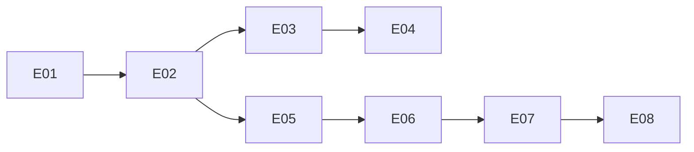

# Tracklite — Execution Plan

| | |
|---|---|
| Version | v1.1 |
| Date | 2026-10-29 |
| Inputs | [`tracklite-spec.md`](tracklite-spec.md) (v0.37) · [`tech-design.md`](tech-design.md) · [`design-system.md`](design-system.md) · the Glance error-handling system (owner's prompt, 2026-10-29) |
| Checks | `npm run lint` → `npm run typecheck` → `npm test` |

The backlog of open work. `/dooo` runs it top to bottom: it takes the first ⬜ row whose dependencies are ✅, does it in one PR, merges it and moves on until every row is ✅.

This batch adopts the Glance error-handling rules: log once at the boundary that turns a fault into an answer, a fixed small set of catch points, one JSON line format written by one function, privacy by construction, and a UI that degrades per data region instead of per page. Glance's file names don't carry over; its rules map onto Tracklite's stack as follows.

| Glance part | In Tracklite | Change |
|---|---|---|
| `Result<T, E>` for expected failures | Domain functions throw `ApiError` (41 sites), caught only by `apiRoute`, which maps it to a status and the spec's message; RTK Query's `baseQuery` already returns `{ data } \| { error }` | **Keep** `ApiError` in the domain (it is never logged and has one catch point, D-42/D-43). Use `Result` only for the outbound email wrapper (E04) |
| Error body `{ "error": "<code>" }` | `{ error: { message, fields? } }`; the server owns all copy (§1.2) | **Keep** |
| Route steps (origin → build → session → schema → service → map) | `apiRoute` does origin 403 → session 401 → Valibot 422 → domain → map | **Keep**; no `426 outdated` build check (no offline client or stored writes; a stale tab reloads on its next page load) |
| Logger `logError(source, event, error, context)` | `src/server/shared/log.ts`: seven ad-hoc `console.log` functions, error class name only | **Replace** with one writer and a closed `source`/`event`/context table (E02) |
| Outbound wrapper | `shared/email/send.ts` (Resend, Mailpit) is the only external dependency | **Change** to log `fetch-failed`/`bad-status`/`bad-response` and return `err("email-failed")` (E04) |
| Server catch points | `apiRoute`'s catch; the worker's per-delivery and per-pass catches | **Add** `onRequestError` in `src/instrumentation.ts`, boot catch in `scripts/`, move worker logs to the new logger (E03). No DB pool listener: postgres.js reconnects on its own and emits no pool `error` event; drizzle issues `ROLLBACK` |
| Offline outbox and sync rules | None (writes go straight to the API; board moves undo on failure) | **Skip** |
| Zones | Each screen renders `Loading` / `LoadFailed` from `src/client/LoadStates.tsx` for the whole page | **Add** `Zone` per data region with its own error boundary (E08) |
| Crash screen | None: a render crash leaves React Router's default error page | **Add** as the router's root `errorElement` and Next's `global-error.tsx` (E07) |
| Client reporter and `POST /api/client-errors` | None | **Add** (E05, E06); no web or service worker, so no `worker-crashed`/`sw-crashed` |
| Multi-tenant tests | One team, no tenants | **Skip** |

**Left to the owner** (L03, [#272](https://github.com/vespaiach/tracklite/pull/272), owner decision 2026-10-26): L03 was closed on local results. These production checks stay with the owner, outside the backlog: SEC-005.1 (HTTP redirects to HTTPS, HSTS sent), SEC-007.2 (proxy access log shows `/reset-password` without the token), OPS-001.1/.2 run on the production host, the team's headcount against spec §3's assumption, NFR-008 in Resend's delivery logs, and the first month's bills against NFR-009.

## Status tracking

| Status | Meaning |
|---|---|
| ⬜ Todo | Not started |
| 🔄 In progress ([#n](#)) | Work has started on its branch. Links the task's PR |
| ✅ Done ([#n](#)) | The task's PR is **merged to the default branch** |

**Rules**
- **Order** is the row order of the Tasks table. Put a task below everything it needs.
- A task is PR-sized (about 0.5–2 days of work), starts with a bold short title (`**Login form**: …`), and has a **Done when** check that can be verified (a test, a command, a page that matches a design).
- **IDs** are a letter and two digits (`A01`), one letter per batch of work. Never reuse an ID.
- **Depends on** lists hard dependencies only, by ID, and only on rows still in this file, or `—`. A task can start once they are ✅. Two tasks that edit the same files (beyond the plan, docs and lockfile) also get a dependency, even without a logical one, so they never run at the same time.
- **Dependency map** (below the table) mirrors the Depends on column: a Mermaid graph and the parallel waves. Tasks in one wave have no path between them, so `/dooo` may run them at the same time. Update the map whenever a row or a dependency changes; the table wins if they disagree.
- One task = one branch (`feat/<ID>-<slug>`) and one PR titled `<ID>: <title>`. The PR's first commit sets the row to 🔄; its last commit before merge sets it to ✅. A closed, unmerged PR resets the row to ⬜.
- **Checks** (header) must all pass locally before the PR is marked ready, and CI (if the repo has any) must be green before merge.
- **Docs move with the code:** a PR that changes behavior, a decision, a schema, an API or the structure updates the spec and/or tech design in the same PR and fixes any row it makes wrong.
- Remove ✅ rows once nothing open depends on them.

## Tasks

Batch: **E** = error handling. E01 writes the rules and example IDs every later row's tests are named after. E02–E04 share `src/server/shared/log.ts` and E06–E08 share `src/client/ClientApp.tsx` and `routes.tsx`, so each group runs one at a time.

| ID | Status | Task | Depends on | Done when | Covers |
|---|---|---|---|---|---|
| E01 | ✅ ([#274](https://github.com/vespaiach/tracklite/pull/274)) | **Spec and design: error logging**: in `docs/tracklite-spec.md` (version bump, changelog line) extend SEC-007 to error lines (no bodies, query strings, tokens, full IPs, emails, description or comment text) and add requirements with examples for the client error report (who may send, what is kept, the 30-per-10-min limit, always `204`), the crash screen (copy "Something went wrong", the 60 s auto-reload, Reload button, no auto-reload on the 3rd crash in 10 min) and a failed data region (what is unavailable, **Try again**). In `docs/tech-design.md` replace §4.8 with an **Error logging** section: the boundary rule and catch-point list, the line format table, the `source`/`event`/context table (`route`, `worker`, `boot`, `mail`, `client`), the never-log list, the client-report flow and `jq` recipes (one line per error, follow live, filter by source, count by source/event, one member's errors, client errors with page/build/component). Add decisions D-47 onward for each **Keep** and **Skip** in the mapping table above. | — | Spec and tech design updated with the new IDs; Checks green | SEC-007 |
| E02 | ⬜ | **One logger**: `logError(source, event, error, context?)` in `src/server/shared/log.ts` writes one JSON line to stderr, keys in order `level, time, source, event, ...context, error`; the `source`/`event` and `LogContext` types are closed and hold every row of E01's table, so E03–E05 don't edit them; `error` is copied field by field (`name`, `message` cut to 500, string/number `code`, `stack`, `cause` 2 levels deep), a non-object becomes `{ name: "Error", message }`, emails become `[email]`, and a `DrizzleQueryError`'s message drops its SQL and params (they can hold description and comment text) keeping the PostgreSQL cause's `code`. The info lines (request, email events, worker metrics) go through the same writer. Turn on Biome `suspicious/noConsole`, allowed only in `log.ts` and `scripts/` (CLI output). Add `spyOnLoggedErrors()` in `src/test/`. | E01 | Logger tests named after E01's examples: key order, whitelisted fields only, `cause` depth cap, email mask, 500-char cut, string error, plain-object error, query params dropped; `npm run lint` fails on a `console.log` outside the allowed files; Checks green | SEC-007 |
| E03 | ⬜ | **Server catch points**: `apiRoute`'s 500 path logs `route/request-failed` with `method`, `path` and `actor`; `register`/`onRequestError` in `src/instrumentation.ts` log `route/request-failed` with `method`, the route pattern and `digest` for pages, `/health` and `/webhooks`; the worker's per-delivery, per-pass, metrics and cleanup catches log `worker/delivery-failed`, `pass-failed`, `metrics-failed` and `cleanup-failed` (with `deliveryId`, never recipient or text); `scripts/worker.ts` and the other scripts log `boot/start-failed` and exit 1. Remove the replaced `log.ts` functions and update §1.4 step 4. | E02 | Tests with `spyOnLoggedErrors()`: a throwing handler logs one `request-failed` and answers 500; `onRequestError` logs the pattern and digest; a failing delivery logs `delivery-failed` and the pass goes on; Checks green | SEC-007 |
| E04 | ⬜ | **Email wrapper**: `sendEmail` returns `Result<{ providerMessageId }, "email-failed">` and logs `mail/fetch-failed` (throw or timeout), `mail/bad-status` (`host`, `status`) or `mail/bad-response` (failing field paths only), never the recipient, key or text. Invitations and password resets turn `err` into `ApiError(503)` so the transaction still rolls back (§1.5); the email channel counts it as a failed attempt. Add the `Result` type (`ok`, `err`) in `src/server/shared/`. | E03 | Tests: a 503 from Resend logs host and status but no URL, key or recipient and the invitation route answers 503 with nothing saved; a timeout logs `fetch-failed`; a failed notification email is retried as before; Checks green | SEC-007, §1.5 |
| E05 | ⬜ | **Client error report endpoint**: `POST /api/client-errors` through `apiRoute("public", …)` (origin check, no session needed); a Valibot schema with `event` one of `uncaught`, `page-crashed`, `zone-crashed` that caps every string (`name` 100, `message` 500, `stack` 4000, `page` and `component` 200 with `page` starting `/`, `digest` 100, `build` 100, `timeZone` 64, `occurredAt` ISO), new fields optional. The service logs `source: "client"` with the member's username **only from the session**, `ip` masked (IPv4 last octet → 0, IPv6 first 3 groups, v4-mapped as v4) from `clientIp`, and the user agent parsed to browser/device and cut to 300. Limit 30 per 10 min per member or IP, using a `client_error_reports` table like `sign_in_attempts` (tech design §4.8). Always `204` when logged or limited. Add the route to §3.3. | E02 | Tests named after E01's examples: session username wins over a body field; IP masking for v4, v4-mapped and v6; UA parse and cut; the 31st report in 10 min answers 204 and logs nothing; route answers 204, 422 for a bad body and 403 cross-site; Checks green | SEC-007, E01's report requirement |
| E06 | ⬜ | **Client reporter**: `createErrorReporter({ fetch, events, online, page, build, now, timeZone })` in `src/client/` returns `report(event, error, extra?)`: cuts strings to E05's caps, sends with `keepalive: true`, de-dupes by message + first stack frame, at most 20 per hour (both reset hourly), queues while offline and flushes on `online`, never throws and drops a failed send. `ClientApp` installs `window` `error` and `unhandledrejection` listeners that report `uncaught`, and provides the reporter through a React context with a no-op default. A guard test fails if any other file under `src` names `/api/client-errors`. Turn on `productionBrowserSourceMaps` in `next.config.ts` (the repository is public). | E05 | Reporter tests: one report per error, cap 20, hourly reset, digest carried, `occurredAt` is the error's time not the send's, offline queue, never throws, non-`Error` value; the guard test passes; Checks green | E01's report requirement |
| E07 | ⬜ | **Crash screen**: a `CrashScreen` rendered by the router's root `errorElement` and by `src/app/global-error.tsx` (which calls the reporter directly, not through context). It reports `page-crashed` once on mount with the `digest` if there is one, shows E01's copy, reloads after a 60 s countdown with a **Reload** button, and counts crashes in `sessionStorage`: on the 3rd within 10 min only the button reloads. Built from kit classes. | E06 | Component tests named after E01's examples: reports once, carries digest, countdown reloads, Reload button, no auto-reload on the 3rd crash; Checks green | E01's crash-screen requirement |
| E08 | ⬜ | **Zones**: `zoneState` (a pure function of an RTK Query result: data wins over a failed refetch; no data and failed, or loading past `useShowLoading`'s delay, → `failed`) and `<Zone state loading empty failed>{(data) => …}</Zone>`, wrapped in an error boundary that shows `failed` on a render crash, reports `zone-crashed` with the first component of React's `componentStack`, and resets when `state` changes. The failed view shows E01's copy and **Try again** (`refetch`). Replace `Loading`/`LoadFailed` with zones per data region: sidebar projects, board, list, My issues, issue fields, comments, and each settings screen; remove `LoadStates.tsx` once unused. | E07 | `zoneState` unit cases; a `Zone` test that a crashing child shows the failed view and reports `zone-crashed`; one representative screen (Issue) shows a failed comments zone while the fields still render; existing screen tests pass; Checks green | E01's data-region requirement |

## Dependency map

| Wave | Tasks (run in parallel) |
|---|---|
| 1 | E01 |
| 2 | E02 |
| 3 | E03, E05 |
| 4 | E04, E06 |
| 5 | E07 |
| 6 | E08 |