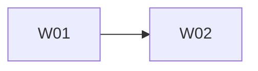

# Tracklite — Execution Plan

| | |
|---|---|
| Version | v1.2 |
| Date | 2026-10-30 |
| Inputs | [`tracklite-spec.md`](tracklite-spec.md) (v0.38) · [`tech-design.md`](tech-design.md) · [`design-system.md`](design-system.md) |
| Checks | `npm run lint` → `npm run typecheck` → `npm test` |

The backlog of open work. `/dooo` runs it top to bottom: it takes the first ⬜ row whose dependencies are ✅, does it in one PR, merges it and moves on until every row is ✅.

**Left to the owner** (L03, [#272](https://github.com/vespaiach/tracklite/pull/272), owner decision 2026-10-26): L03 was closed on local results. These production checks stay with the owner, outside the backlog: SEC-005.1 (HTTP redirects to HTTPS, HSTS sent), SEC-007.2 (proxy access log shows `/reset-password` without the token), creating the first admin through the welcome screen on the production host once W02 ships (OPS-001, with `SETUP_SECRET` set in the server config), the team's headcount against spec §3's assumption, NFR-008 in Resend's delivery logs, and the first month's bills against NFR-009.

## Status tracking

| Status | Meaning |
|---|---|
| ⬜ Todo | Not started |
| 🔄 In progress ([#n](#)) | Work has started on its branch. Links the task's PR |
| ✅ Done ([#n](#)) | The task's PR is **merged to the default branch** |

**Rules**
- **Order** is the row order of the Tasks table. Put a task below everything it needs.
- A task is PR-sized (about 0.5–2 days of work), starts with a bold short title (`**Login form**: …`), and has a **Done when** check that can be verified (a test, a command, a page that matches a design).
- **IDs** are a letter and two digits (`A01`), one letter per batch of work. Never reuse an ID.
- **Depends on** lists hard dependencies only, by ID, and only on rows still in this file, or `—`. A task can start once they are ✅. Two tasks that edit the same files (beyond the plan, docs and lockfile) also get a dependency, even without a logical one, so they never run at the same time.
- **Dependency map** (below the table) mirrors the Depends on column: a Mermaid graph and the parallel waves. Tasks in one wave have no path between them, so `/dooo` may run them at the same time. Update the map whenever a row or a dependency changes; the table wins if they disagree.
- One task = one branch (`feat/<ID>-<slug>`) and one PR titled `<ID>: <title>`. The PR's first commit sets the row to 🔄; its last commit before merge sets it to ✅. A closed, unmerged PR resets the row to ⬜.
- **Checks** (header) must all pass locally before the PR is marked ready, and CI (if the repo has any) must be green before merge.
- **Docs move with the code:** a PR that changes behavior, a decision, a schema, an API or the structure updates the spec and/or tech design in the same PR and fixes any row it makes wrong.
- Remove ✅ rows once nothing open depends on them.

## Tasks

Batch: **W** = welcome screen for first-admin setup (spec 0.38, OPS-001; tech design 1.6, 1.7, 3.3, 4.6, 6.1, D-54). The spec and tech design are already updated, so the rows only build and test. W02 wires up W01's endpoints, so it runs second.

| ID | Status | Task | Depends on | Done when | Covers |
|---|---|---|---|---|---|
| W01 | ✅ ([#284](https://github.com/vespaiach/tracklite/pull/284)) | **Setup API**: optional `SETUP_SECRET` in `readConfig` (refused under 32 characters) and commented in `.env.example`. In `src/server/identity/setup.ts`, `setupNeeded()`, `checkSetupSecret(secret)` and `createFirstAdmin({ secret, email, fullName, username, password })` follow tech design 4.6: `ApiError` 410 "Setup already done", 503 "Setup isn't enabled. Set SETUP_SECRET on the server and restart.", 403 "Wrong setup secret"; `timingSafeEqual` on the `hashToken` of both secrets; the existing members-table lock; `createSession(member.id, tx)`; returns `{ member, sessionToken }` like `acceptInvitation`. `FirstAdmin` gains `secret`; add `SetupCheck`; export through `identity/index.ts`. Public routes `GET`/`POST /api/setup` (`201` with `profileResponse(member) satisfies Me` and `sessionCookie`) and `POST /api/setup-checks` (`204`); `SetupStatus` in `src/contract/`. Delete `scripts/setup.ts`, the `setup` npm script, and the `npm run setup` lines in `README.md` and `CLAUDE.md`. | — | `setup.test.ts` tests named OPS-001.1 (creates the admin and returns a session token that signs in, keeping REQ-003.1's lowercase username), .2, .3, .4 and .7, plus the existing bad-input test; a route test that `POST /api/setup` answers `201` with the cookie and `GET` reports `needed`; a config test for OPS-001.6; `grep -rn "npm run setup" .` finds nothing outside `docs/`; Checks green | OPS-001 |
| W02 | 🔄 | **Welcome screen**: lazy `welcome` route in `src/client/routes.tsx`, `/welcome` added to `signedOutPaths` in `src/client/api.ts`, and RTK Query endpoints `setupStatus`, `checkSetupSecret` and `createFirstAdmin` (invalidates `Me`). `src/client/screens/Welcome.tsx`, built from the SignedOut kit pieces as in `AcceptInvitation.tsx`: step 1 is the secret, with the server's message on failure; step 2 is email, full name, username, and password twice, with field errors from the `422`; success goes to `/my-issues`; it goes to `/sign-in` when `needed` is false. `SignIn.tsx` goes to `/welcome` while `needed` is true (tech design 1.7). | W01 | `Welcome.test.tsx` against mocks, tests named OPS-001.1 (secret then form, lands on My issues), OPS-001.2 (not needed → sign-in), OPS-001.3 (wrong secret: message shown, profile fields hidden) and OPS-001.4 (the not-enabled message); a `SignIn` test named OPS-001.5 (needed → `/welcome`); manual run on a dropped and migrated, unseeded dev database with `SETUP_SECRET` set; Checks green | OPS-001 |

## Dependency map

| Wave | Tasks (run in parallel) |
|---|---|
| 1 | W01 |
| 2 | W02 |