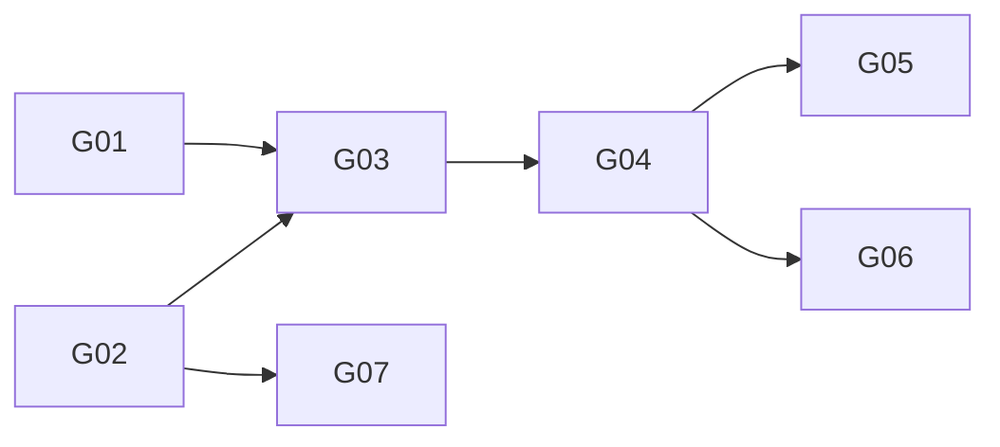

# Tracklite — Execution Plan

| | |
|---|---|
| Version | v1.3 |
| Date | 2026-11-05 |
| Inputs | [`tracklite-spec.md`](tracklite-spec.md) (v0.39) · [`tech-design.md`](tech-design.md) · [`design-system.md`](design-system.md) |
| Checks | `npm run lint` → `npm run typecheck` → `npm test` |

The backlog of open work. `/dooo` runs it top to bottom: it takes the first ⬜ row whose dependencies are ✅, does it in one PR, merges it and moves on until every row is ✅.

**Left to the owner** (L03, [#272](https://github.com/vespaiach/tracklite/pull/272), owner decision 2026-10-26): L03 was closed on local results. These production checks stay with the owner, outside the backlog: SEC-005.1 (HTTP redirects to HTTPS, HSTS sent), SEC-007.2 (proxy access log shows `/reset-password` without the token), creating the first admin through the welcome screen on the production host (W02, [#285](https://github.com/vespaiach/tracklite/pull/285); OPS-001, with `SETUP_SECRET` set in the server config), the team's headcount against spec §3's assumption, NFR-008 in Resend's delivery logs, and the first month's bills against NFR-009.

## Status tracking

| Status | Meaning |
|---|---|
| ⬜ Todo | Not started |
| 🔄 In progress ([#n](#)) | Work has started on its branch. Links the task's PR |
| ✅ Done ([#n](#)) | The task's PR is **merged to the default branch** |

**Rules**
- **Order** is the row order of the Tasks table. Put a task below everything it needs.
- A task is PR-sized (about 0.5–2 days of work), starts with a bold short title (`**Login form**: …`), and has a **Done when** check that can be verified (a test, a command, a page that matches a design).
- **IDs** are a letter and two digits (`A01`), one letter per batch of work. Never reuse an ID.
- **Depends on** lists hard dependencies only, by ID, and only on rows still in this file, or `—`. A task can start once they are ✅. Two tasks that edit the same files (beyond the plan, docs and lockfile) also get a dependency, even without a logical one, so they never run at the same time.
- **Dependency map** (below the table) mirrors the Depends on column: a Mermaid graph and the parallel waves. Tasks in one wave have no path between them, so `/dooo` may run them at the same time. Update the map whenever a row or a dependency changes; the table wins if they disagree.
- One task = one branch (`feat/<ID>-<slug>`) and one PR titled `<ID>: <title>`. The PR's first commit sets the row to 🔄; its last commit before merge sets it to ✅. A closed, unmerged PR resets the row to ⬜.
- **Checks** (header) must all pass locally before the PR is marked ready, and CI (if the repo has any) must be green before merge.
- **Docs move with the code:** a PR that changes behavior, a decision, a schema, an API or the structure updates the spec and/or tech design in the same PR and fixes any row it makes wrong.
- Remove ✅ rows once nothing open depends on them.

## Tasks

Batch: **G** = domain-driven design: aggregates, a read side and domain errors (tech design 1.2, 1.4, 1.8, 3.2, 4.10, D-47, D-55 to D-59). Nothing a member sees changes, so the spec doesn't change. The tech design is already updated, so the rows only build and test, and every existing test stays green unless a row moves it. **Owner checkpoint:** G05 and G06 start only once the owner has reviewed G03, the pilot, and agreed to go on; if not, they're removed and 1.8 is trimmed back to what was built.

| ID | Status | Task | Depends on | Done when | Covers |
|---|---|---|---|---|---|
| G01 | ✅ ([#288](https://github.com/vespaiach/tracklite/pull/288)) | **Domain errors**: `src/server/shared/domain-error.ts` with `DomainError(kind, message, fields?)` and the kinds `signedOut`, `forbidden`, `notFound`, `conflict`, `expired`, `invalid`, `limited` and `unavailable` (tech design 3.2). `apiRoute` maps each kind to its status. Every `new ApiError(` under `src/server/` and `src/app/` becomes a `DomainError` with the same message and fields; delete `shared/api-error.ts`. | — | One `api-route.test.ts` test checks each kind's status and body; `grep -rn "ApiError" src` finds nothing; Checks green | STD-2, STD-3 |
| G02 | ✅ ([#289](https://github.com/vespaiach/tracklite/pull/289)) | **Model guard**: `architecture.test.ts` gains `G02: model and rules files import no database, HTTP or framework code`: a `model.ts` or `rules.ts` under `src/server/` may not import `drizzle-orm`, `shared/db`, `shared/transaction`, `shared/api-route` or `next/*` (tech design 1.8). | — | The test passes on the current tree and fails when `drizzle-orm` is imported in `issues/rules.ts` (checked by hand, not committed); Checks green | — |
| G03 | ✅ ([#290](https://github.com/vespaiach/tracklite/pull/290)) | **Issue aggregate (pilot)**: `issues/model.ts` with the `Issue` type (row fields, assignees, label ids), `newIssue`, `retitle`, `changeStatus`, `changePriority`, `assign`, `relabel`, `move`, `saveDescription` and `mayDeleteIssue`, each change returning `{ issue, events }` (1.8 Aggregates); it absorbs `issues/rules.ts`, and `rules.test.ts` becomes `model.test.ts`. `issues/repository.ts` with `loadIssue(tx, id)` (locked), `toIssue(rows)` and `saveIssue(tx, before, after)`. `create.ts`, `update.ts` and `board.ts`'s `moveIssue` become commands: load → model → save → publish → response. | G01, G02 | Existing issue, board and notification tests pass unchanged; `model.test.ts` holds the moved rule tests under their old names, without a database; `create.ts`, `update.ts` and `moveIssue` contain no `tx.select`, `tx.insert`, `tx.update` or `tx.delete`; Checks green | REQ-016, REQ-017, REQ-019, REQ-020, REQ-023, REQ-026, REQ-027, REQ-043 |
| G04 | ✅ ([#291](https://github.com/vespaiach/tracklite/pull/291)) | **Read side**: `src/server/queries/` with an `index.ts`. Move into it the reads in `issues/list.ts`, `issues/board.ts` (`getBoard`), `issues/rows.ts` (the issue response and the issue-ID condition), `projects/projects.ts` (summaries, details, issue counts), `projects/labels.ts` (labels with counts) and `comments/comments.ts` (threads and their mentions); routes and commands call them there. `architecture.test.ts` lets `queries` import any context's `tables.ts` and `schemas.ts`, and `tableReadsAgainstMap` is deleted (D-57). | G03 | `tableReadsAgainstMap` is gone and M15, M16 and G02 pass; route tests pass unchanged; Checks green | REQ-024, REQ-036, REQ-041, REQ-046 |
| G05 | ✅ ([#292](https://github.com/vespaiach/tracklite/pull/292)) | **Project aggregate**: `projects/model.ts` with `Project` (row, key, labels), `newProject`, `rename`, `archive`, `unarchive`, `saveDescription` and the label changes (create, rename, recolor, delete); `projects/repository.ts`; `projects.ts` and `labels.ts` become commands; `projects/rules.ts` folds into `model.ts`. | G04 | As G03, for projects and labels; Checks green | REQ-009, REQ-013, REQ-021 |
| G06 | ✅ ([#293](https://github.com/vespaiach/tracklite/pull/293)) | **Comment aggregate**: `comments/model.ts` with `Comment`, `newComment`, `edit` and `mayDeleteComment`; `comments/repository.ts`; `comments.ts` becomes commands; `comments/rules.ts` folds into `model.ts`. | G04 | As G03, for comments; Checks green | REQ-031, REQ-033, REQ-034, STD-8 |
| G07 | ⬜ | **Delivery model**: `notifications/model.ts` with the `Delivery` type, `checkedMessage` and `stillWanted` moved from `worker.ts`, and `afterFailure(attempts)` (a retry after 1, 4 or 10 minutes, then `failed`) replacing the decision in `recordFailure`. `worker.ts` keeps the loop, heartbeat, metrics, claim, lease and record SQL (tech design 1.4). The drop-check and retry cases move from `worker.test.ts` to `model.test.ts` under their old names. | G02 | `model.test.ts` runs without a database and holds the moved cases; `worker.test.ts` keeps only claim, lease, send and record tests; Checks green | REQ-043, REQ-044, REQ-045 |

## Dependency map

| Wave | Tasks (run in parallel) |
|---|---|
| 1 | G01, G02 |
| 2 | G03, G07 |
| 3 | G04 |
| 4 | G05, G06 |